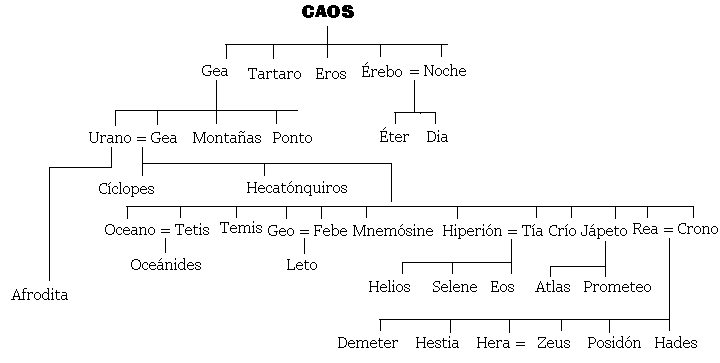

# 🏺 UD3 · Mitoloxía e Relixión: deuses, heroes e pervivencia

!!! info "Obxectivos da unidade"
- Comprender que é un **mito** e cal é a súa función nunha sociedade pre-científica.
- Explicar a **cosmogonía e teogonía gregas**: Caos → Xea → Urano → Titáns → Olímpicos.
- Coñecer os principais **deuses olímpicos**, os **heroes** e os mitos fundamentais.
- Identificar procedencias, temas, estruturas e valores transmitidos polo mito.
- Analizar a **pervivencia da mitoloxía** na cultura actual (cómic, cine, música, marcas, política…).
- Crear un produto final: **díptico “mito onte / mito hoxe”**.

---

# 1. Que é a mitoloxía?

A **mitoloxía** é o conxunto de narracións tradicionais coas que unha sociedade explica o mundo, a orixe da vida, os fenómenos naturais, a convivencia humana e a súa relación co sagrado.
Nun tempo sen ciencia nin métodos experimentais, o mito constituía unha forma **seria e eficaz** de coñecemento: unha maneira simbólica de ordenar o descoñecido, de dar sentido ao que non tiña explicación inmediata.

Os mitos cumprían funcións moi diversas:

* **Explicativa**: respondían á pregunta pola orixe do cosmos, dos deuses e da humanidade.
* **Social**: transmitían modelos de comportamento (hospitalidade, moderación, valentía) e advertían contra as condutas perigosas.
* **Relixiosa**: estruturaban rituais, festas e cultos; explicaban por que se honra un deus e como debe facerse.
* **Identitaria**: cada comunidade recoñecíase nun conxunto propio de deuses, heroes e lendas.
* **Educativa**: ofrecían exemplos e anti-exemplos, configurando unha ética colectiva.
* **Estética e cultural**: alimentaban a literatura, a arte, o teatro e a imaxinación do pobo grego.

É importante subliñar que os gregos **non eran inxenuos** nin “crían literalmente” cada relato tal como o contamos hoxe. Sabían que existían distintas versións dun mesmo mito, reinterpretábano constantemente e utilizábano como **linguaxe simbólica** para pensar cuestións profundas: o poder, a xustiza, o destino, o paso do tempo, a violencia ou a fragilidade humana.

Por iso dicimos que o mito non é un conto infantil, senón unha **forma primitiva pero sofisticada de filosofía narrada**. Igual que hoxe empregamos películas, novelas ou series para expresar ideas complexas, os gregos utilizaban o mito para dotar de sentido á súa experiencia e á do seu pobo.

---

# 2. Cosmogonía e teogonía: de onde vén todo?

As fontes principais son **Hesíodo** (*Teogonía*, s. VIII a.n.e.) e a tradición épica arcaica.

## 2.1 Cosmogonía: a creación do mundo

Segundo Hesíodo:

1. **Caos** → baleiro inicial, fenda primixenia. De Caos xorden:

      * **Érebo** (escuridade fonda)
      * **Nix** (noite)
      *  Da unión de Nix e Érebo [nacen](image.png):

         * **Éter** (luz superior)
         * **Hemera** (día)
  
2. **Xea (Terra)** → fundamento firme da vida. De Xea (sen concepción) nacen:

      * **Urano** (ceo estrellado)
      * As **Montañas**
      * O **Ponto** (mar)

3. **Tártaro** → profundidade subterránea.
4. **Eros** → forza do amor, que une e permite crear.
  

A cosmogonía grega é un proceso de **ordeación progresiva**: do baleiro → luz → terra → ceo → vida.

---

## 2.2 Teogonía: nacemento dos deuses

De **Xea** e **Urano** nacen os **Titáns**, os **Cíclopes** e os **Hecatónquiros**.

### Os Titáns principais

* **Océano** e **Tetis** (augas do mundo)
* **Hiperión**, **Tea**, **Selene**, **Helios**, **Eos**
* **Rea** e **Cronos**
* **Temis**, **Mnemósine**, **Febe**, **Xápeto**, **Ceo**, **Crío**

Urano odiaba os seus fillos máis monstruosos e impedía que nacesen.
Xea, farta, preparou unha **fouce** e pediu axuda.
Só **Cronos** se atreveu a actuar: castrou a Urano e iniciou a **era dos Titáns**.

Do sangue caído sobre Xea naceron:

* As **Erinias**
* Os **Xigantes**
* As **Ninfas Melias**

Dos xenitais arroxados ao mar naceu **Afrodita**.

---

## 2.3 A titanomaquia

Cronos gobernou, pero temía unha profecía: sería destronado polo seu propio fillo.
Para evitalo, **tragaba aos seus fillos** a medida que nacían. Pero **Rea**, desesperada, ocultou ao último: **Zeus**.

Zeus creceu en Creta e, ao facerse forte, obrigou a Cronos a vomitar os seus irmáns. Comezou así a **guerra entre Titáns e Olímpicos**:

* Olímpicos: Zeus, Hera, Hestia, Deméter, Poseidón, Hades.
* Aliados: Cíclopes (que lle deron a Zeus o raio), Hecatónquiros.

A vitoria de Zeus marcou o **inicio da orde olímpica** e o establecemento dun cosmos organizado baixo o seu mando.

## 2.4 Antropogonía: a creación da humanidade

A mitoloxía grega ofrece varias explicacións sobre a orixe dos seres humanos. As máis destacadas son:

1. **Prometeo e Epimeteo** (Hesíodo): o ser humano recibe o lume e a técnica para sobrevivir.
2. **As cinco idades da humanidade** (Hesíodo): visión histórica e moral da degradación humana.
3. **Tradición órfica**: os humanos nacen da mestura de Titáns (violencia) e Dioniso (divindade).

Estas historias non buscan describir un feito histórico, senón reflexionar sobre a condición humana: debilidade, creatividade, soberbia, sufrimento, esperanza.

---

# 3. Os deuses olímpicos

A seguinte táboa resume os principais olímpicos, o seu dominio e atributos.

| Deus/Deusa   | Dominio               | Atributos                 |
| ------------ | --------------------- | ------------------------- |
| **Zeus**     | ceo, orde, xustiza    | raio, aguia               |
| **Hera**     | matrimonio            | pavo real, coroa          |
| **Posidón**  | mar, terremotos       | tridente                  |
| **Deméter**  | agricultura           | espigas                   |
| **Atenea**   | sabedoría, estratexia | casco, oliva, curuxa      |
| **Apolo**    | luz, música, profecía | lira, arco                |
| **Ártemis**  | caza, natureza        | arco, corzo               |
| **Ares**     | guerra                | lanza, escudo             |
| **Afrodita** | amor, beleza          | cuncha, pomba             |
| **Hefesto**  | lume, artesanía       | martelo, forno            |
| **Hermes**   | mensaxeiro, comercio  | caduceo, sandalias aladas |
| **Dioniso**  | viño, teatro          | tirso, vide               |

---

# 4. Heroes e heroínas

Os heroes representan valores, conflitos e límites da condición humana. Non son perfectos, senón **paradigmas morais**.

### Heroes principais

* **Heracles** → esforzo, superación do trauma.
* **Perseo** → coraxe e intelixencia (Medusa).
* **Teseo** → orde e civilización (Minotauro).
* **Ulises / Odiseo** → astucia, resistencia, identidade.
* **Aquiles** → honra, ira, destino.
* **Xasón e os Argonautas** → aventura e fracaso político.

### Heroínas e deusas heroicas

* **Atalanta**, corredora invencible.
* **Penélope**, fidelidade e intelixencia.
* **Medea**, conflito cultural e vinganza.
* **Antígona**, ética persoal vs. lei do Estado.

---

# 5. A función social do mito

O mito serve como:

* **Modelo moral**: o que se debe e non se debe facer.
* **Explicación do mundo**: por que hai mar, lume, estacións…
* **Control social**: castigos divinos, límites, leis implícitas.
* **Xustificación política**: orixes divinas das cidades.
* **Identidade colectiva**: cada polis ten un fundador heroico.
* **Base da relixión**: os mitos conectan con rituais e festas.

---

# 6. Relixión grega: como se relacionaban cos deuses?

A relixión grega era:

* **Politeísta**: moitos deuses con dominios distintos.
* **Ritualista**: máis importante o rito que a crenza interior.
* **Cívica**: a comunidade organizaba cultos e festas.
* **Antropomórfica**: os deuses teñen forma e comportamento humano.
* **Sincrética**: as polis compartían deuses pero con cultos locais.

## Prácticas relixiosas

* **Sacrificios e banquetes rituais**.
* **Festas** (Panateneas, Dionisias…).
* **Oráculos** (Delfos, Dódona).
* **Purificacións**.
* **Votos, procesións, competicións deportivas** (Xogos Olímpicos).

---

# 7. A mitoloxía na cultura romana

Roma **non copia**, senón que **adapta**:

* Zeus → **Xúpiter**
* Hera → **Xuno**
* Poseidón → **Neptuno**
* Afrodita → **Venus**
* Ares → **Marte**
* Hermes → **Mercurio**
* Atenea → **Minerva**

Roma enfatiza:

* o carácter **moral e exemplar** dos deuses,
* a **idea de disciplina**,
* o **poder do Estado** como vontade divina.

---

# 8. Pervivencia do mito: onde aparece hoxe?

O mito segue vivo porque seguimos precisando **símbolos**, **relatos** e **personaxes arquétipos**.

## Onde aparece?

* **Publicidade**: Nike (deusa da vitoria), Versace (Medusa), Starbucks (sereas).
* **Cine**: Marvel (Thor, Loki), *Troia*, *Percy Jackson*.
* **Música**: Rosalía (Caronte, mito do paso), Anier (Medusa).
* **Videoxogos**: *Hades*, *God of War*, *Assassin’s Creed*.
* **Política**: uso simbólico do Olimpo, do titán, do labirinto.
* **Linguaxe común**: “talón de Aquiles”, “abrir a caixa de Pandora”, “traballo titánico”.

O mito funciona como **linguaxe universal** para expresar emocións, conflitos e ideas.

---

# 9. Actividades da unidade

### 1. Liña do tempo de creación

Comparar:

* Cosmogonía grega
* Xénese bíblico
* Cosmogonías nórdicas / sumerias
* Big Bang

### 2. Mapa olímpico

Crear un mapa da Grecia clásica onde situar:

* Santuarios
* Cidades asociadas a cada deus
* Mitos locais

### 3. Lectura de textos

* Hesíodo, *Teogonía* (selección).
* Homero, *Odisea* (episodios de deuses e monstros).

### 4. Análise de obras de arte

* Botticelli: *Nacemento de Venus*.
* Goya: *Saturno devorando o seu fillo*.
* Vasari: *Castración de Urano*.

### 5. Creación final: Díptico *Mito Onte / Mito Hoxe*

Cada alumno escolle un mito e crea un díptico:

* Panel 1 → obra clásica (cerámica, escultura, texto).
* Panel 2 → pervivencia actual (cómic, película, canción, logo).
* Pequena explicación textual.

---

# 10. Lembranza final

> ✨ *O mito non desaparece: transfórmase.
> Seguimos usando historias antigas para explicar os nosos medos, desexos e conflitos.*
> Por iso a mitoloxía grega segue viva hoxe.
